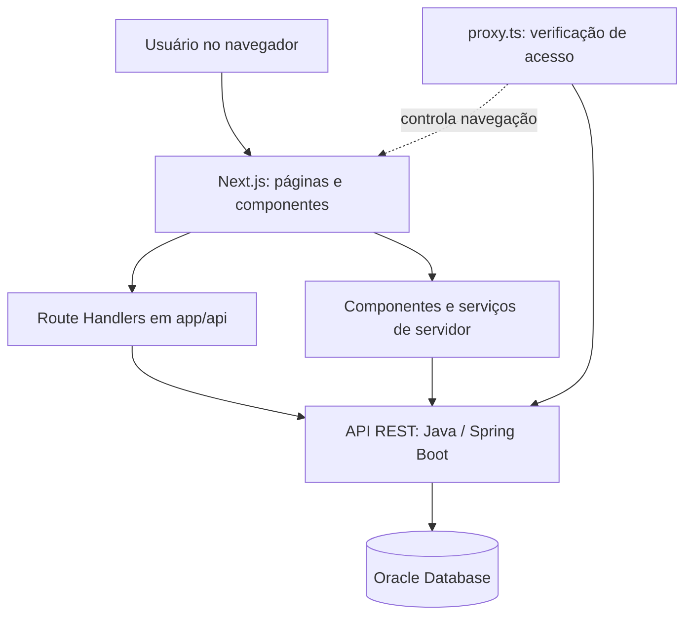
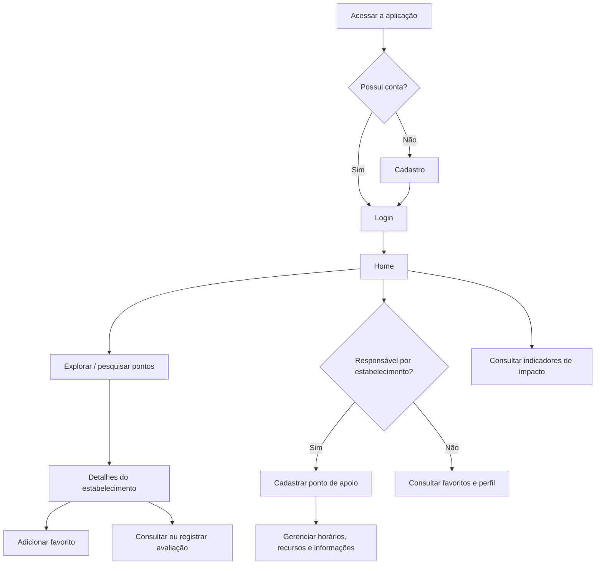

# Parô — Frontend

> **Global Solution 2026 · FIAP · CitizenTech**  
> Aplicação web para descobrir, avaliar e gerenciar pontos de apoio destinados a motoristas, entregadores e outros trabalhadores que passam o dia nas ruas.

[](https://nextjs.org/)
[](https://react.dev/)
[](https://www.typescriptlang.org/)
[](https://tailwindcss.com/)

**Repositórios:** [Frontend — GS2---Paro](https://github.com/Lsko27/GS2---Paro) · [Backend — Paro-Java-Backend](https://github.com/Lsko27/Paro-Java-Backend)

---

## Sumário

1. [Visão geral](#1-visão-geral)
2. [Funcionalidades](#2-funcionalidades)
3. [Tecnologias](#3-tecnologias)
4. [Arquitetura](#4-arquitetura)
5. [Estrutura de diretórios](#5-estrutura-de-diretórios)
6. [Páginas e navegação](#6-páginas-e-navegação)
7. [Integração com a API Java](#7-integração-com-a-api-java)
8. [Autenticação e segurança](#8-autenticação-e-segurança)
9. [Configuração do ambiente](#9-configuração-do-ambiente)
10. [Instalação e execução](#10-instalação-e-execução)
11. [Qualidade e validação](#11-qualidade-e-validação)
12. [Fluxo de utilização](#12-fluxo-de-utilização)
13. [Limitações e cuidados de implantação](#13-limitações-e-cuidados-de-implantação)
14. [Contexto acadêmico](#14-contexto-acadêmico)

## 1. Visão geral

O **Parô** é um MVP desenvolvido para a Global Solution 2026 da FIAP, no contexto do desafio **CitizenTech**. A proposta enfrenta uma dificuldade cotidiana de trabalhadores em deslocamento: encontrar locais com **água potável, banheiro, descanso e outros recursos essenciais**, com informações claras sobre disponibilidade e condições de acesso.

A interface conecta dois perfis de usuário:

- **Trabalhadores e usuários da plataforma:** pesquisam pontos de apoio, consultam detalhes, salvam favoritos e registram avaliações.
- **Responsáveis por estabelecimentos:** cadastram e gerenciam pontos de apoio, horários de funcionamento, recursos e condições de acesso.

O frontend prioriza a experiência **mobile-first**, mas também pode ser acessado em navegadores de desktop. Os dados são fornecidos por uma API REST Java; o frontend não acessa diretamente o banco Oracle.

## 2. Funcionalidades

| Área                 | Funcionalidades                                                                                       |
| -------------------- | ----------------------------------------------------------------------------------------------------- |
| **Conta**            | Cadastro, login, logout e consulta de perfil autenticado                                              |
| **Exploração**       | Pesquisa por nome e busca de estabelecimentos próximos por geolocalização                             |
| **Mapa**             | Visualização geográfica dos pontos de apoio com Leaflet e React Leaflet                               |
| **Detalhes**         | Endereço, descrição, recursos, disponibilidade, horários, condições de acesso e avaliações            |
| **Favoritos**        | Adição, listagem e remoção de estabelecimentos favoritos                                              |
| **Avaliações**       | Consulta de notas e comentários; envio de avaliação, respeitando as regras da API                     |
| **Estabelecimentos** | Cadastro, edição e gerenciamento das informações pelo responsável                                     |
| **Recursos**         | Associação de água, banheiro, descanso e outros itens do catálogo ao estabelecimento                  |
| **Impacto**          | Indicadores agregados sobre estabelecimentos, bairros atendidos e recursos disponíveis                |
| **Segurança**        | Rotas privadas, validação de sessão, CSRF e apresentação de erros de autenticação, inclusive HTTP 429 |

> **Regra de negócio:** a prevenção de avaliações duplicadas e o controle de propriedade dos estabelecimentos são reforçados pelo backend e pelas restrições do banco de dados; a interface não substitui essas verificações.

## 3. Tecnologias

Versões declaradas no `package.json` da aplicação:

| Categoria           | Tecnologia                                           | Versão declarada / uso                             |
| ------------------- | ---------------------------------------------------- | -------------------------------------------------- |
| Framework           | **Next.js**                                          | `16.4.5`, App Router                               |
| Interface           | **React / React DOM**                                | `19.3.0`                                           |
| Linguagem           | **TypeScript**                                       | `^5`                                               |
| Estilização         | **Tailwind CSS**                                     | `^4`                                               |
| Componentes         | **shadcn/ui**, **Base UI**                           | `shadcn ^4.23.0`, `@base-ui/react ^1.9.0`          |
| Formulários         | **React Hook Form**                                  | `^7.86.0`                                          |
| Validação           | **Zod** e `@hookform/resolvers`                      | `^4.6.7` e `^7.0.5`                                |
| Mapas               | **Leaflet** / **React Leaflet**                      | `^1.9.4` / `^5.0.0`                                |
| Ícones              | **Lucide React**                                     | `^1.69.0`                                          |
| Estilos utilitários | **class-variance-authority**, `cn`, `tw-animate-css` | Componentes, variantes e animações                 |
| Qualidade           | **ESLint**, **Prettier**                             | Lint e formatação                                  |
| Git hooks           | **Husky**, **lint-staged**, **Commitlint**           | Padronização e verificações relacionadas a commits |

Configurações observadas em `next.config.ts`: **Cache Components** e **Partial Prefetching** estão habilitados, com Turbopack no processo de build. Algumas páginas usam `<Suspense>` para trabalhar com dados obtidos em tempo de requisição.

## 4. Arquitetura

O frontend usa **Next.js App Router** e separa apresentação, serviços e integração com o backend. Parte das chamadas ocorre por **Route Handlers** em `app/api`, que funcionam como uma camada intermediária (_Backend for Frontend_, ou BFF).



**Responsabilidades principais:**

- **Páginas (`app/`)**: rotas, layouts e renderização de interface.
- **Componentes (`app/_components/`)**: elementos compartilhados, navegação, formulários e componentes visuais.
- **UI (`app/_components/ui/`)**: componentes reutilizáveis baseados em shadcn/ui.
- **Serviços (`app/_services/`)**: operações e adaptações entre os contratos da API Java e os tipos consumidos pela interface.
- **Bibliotecas (`app/_lib/`)**: utilitários e helpers de integração HTTP.
- **Tipos (`app/_types/`)**: definições TypeScript dos dados manipulados pela aplicação.
- **Route Handlers (`app/api/`)**: endpoints do Next.js que encaminham ou adaptam chamadas para o backend.
- **Proxy (`proxy.ts`)**: verifica a existência e a validade da sessão antes de permitir a navegação nas rotas configuradas.

Os nomes de propriedades da API Java, como `nome`, `descricao` e `senha`, podem permanecer em português no contrato HTTP. A camada frontend faz as adaptações necessárias para os modelos TypeScript usados pela interface.

## 5. Estrutura de diretórios

Estrutura resumida dos principais diretórios e arquivos:

```text
GS2---Paro/
├── app/
│   ├── (protected)/
│   │   ├── home/
│   │   ├── explore/
│   │   ├── impact/
│   │   ├── profile/
│   │   └── establishments/
│   │       ├── new/
│   │       └── [id]/
│   │           └── manage/
│   ├── favorites/
│   ├── login/
│   ├── register/
│   ├── api/
│   │   ├── auth/
│   │   ├── establishments/
│   │   ├── favorites/
│   │   ├── geocoding/
│   │   ├── resources/
│   │   └── users/
│   ├── _components/
│   │   └── ui/
│   ├── _lib/
│   ├── _services/
│   ├── _types/
│   ├── globals.css
│   └── layout.tsx
├── public/
├── proxy.ts
├── next.config.ts
├── package.json
├── package-lock.json
├── tsconfig.json
├── eslint.config.mjs
├── .prettierrc.json
├── commitlint.config.cjs
└── README.md
```

> O grupo `(protected)` organiza páginas sem alterar suas URLs. A efetiva proteção das páginas depende do `matcher` e da lógica de `proxy.ts`, não do nome da pasta.

## 6. Páginas e navegação

| URL                           | Conteúdo                                    | Acesso atual                                    |
| ----------------------------- | ------------------------------------------- | ----------------------------------------------- |
| `/`                           | Página inicial pública/entrada da aplicação | Público                                         |
| `/login`                      | Autenticação                                | Público                                         |
| `/register`                   | Cadastro de usuário                         | Público                                         |
| `/home`                       | Área principal e descoberta de pontos       | Autenticado                                     |
| `/explore`                    | Busca e exploração de estabelecimentos      | Autenticado                                     |
| `/impact`                     | Indicadores de impacto da plataforma        | Autenticado                                     |
| `/profile`                    | Perfil do usuário                           | Autenticado                                     |
| `/favorites`                  | Lista pessoal de estabelecimentos favoritos | Autenticado                                     |
| `/establishments/new`         | Cadastro de ponto de apoio                  | Autenticado; regras adicionais do backend       |
| `/establishments/[id]`        | Detalhes públicos do ponto de apoio         | Página fora do `matcher` de proteção            |
| `/establishments/[id]/manage` | Gerenciamento de um estabelecimento         | Autenticado; propriedade conferida pelo backend |

A lista de rotas protegidas é definida em `proxy.ts`. O navegador é redirecionado para `/login` em caso de sessão ausente ou rejeitada pelo backend. A página de detalhes não está coberta pelo `matcher` atual, conforme a configuração consultada.

## 7. Integração com a API Java

### Configuração da URL do backend

O servidor Next.js utiliza a variável:

```dotenv
BACKEND_API_URL=http://localhost:8080/api/v1
```

A URL deve incluir o prefixo `/api/v1`, pois os Route Handlers e serviços concatenam caminhos como `/auth/login`, `/recursos` e `/estabelecimentos`.

### Camada de serviços

O helper `app/_lib/api.ts` consulta o backend a partir do servidor Next.js, com `fetch` e política `cache: "no-store"`. O helper `app/_lib/forward-backend-request.ts` encaminha operações HTTP e preserva, conforme a resposta de origem, códigos de status, cookies e cabeçalhos relevantes.

### Principais endpoints do BFF do Next.js

Os caminhos abaixo pertencem ao **frontend** (`http://localhost:3000/api/...`), não à API Java diretamente.

| Grupo                  | Endpoints utilizados                                                                                                                                              |
| ---------------------- | ----------------------------------------------------------------------------------------------------------------------------------------------------------------- |
| Autenticação           | `/api/auth/register`, `/api/auth/login`, `/api/auth/logout`, `/api/auth/me`, `/api/auth/csrf`                                                                     |
| Estabelecimentos       | `/api/establishments`, `/api/establishments/[id]`, `/api/establishments/mine`                                                                                     |
| Busca                  | `/api/establishments/search`, `/api/establishments/text-search`                                                                                                   |
| Gerenciamento          | `/api/establishments/[id]/access-conditions`, `/api/establishments/[id]/hours`, `/api/establishments/[id]/resources`, `/api/establishments/[id]/resources/manage` |
| Avaliações             | `/api/establishments/[id]/reviews`, `/api/establishments/[id]/reviews/summary`                                                                                    |
| Associação de recursos | `/api/establishments/resources/[associationId]`                                                                                                                   |
| Favoritos              | `/api/favorites`, `/api/favorites/[establishmentId]`                                                                                                              |
| Outros                 | `/api/resources`, `/api/geocoding`, `/api/users/me`                                                                                                               |

> Os métodos HTTP e os formatos de entrada devem ser consultados nos respectivos arquivos `route.ts`. Um caminho pode oferecer diferentes métodos, dependendo de sua implementação.

### Exemplo: login

Fluxo utilizado pelo formulário de login:

1. O navegador solicita `GET /api/auth/csrf` e recebe o token de proteção.
2. O formulário envia `POST /api/auth/login` com e-mail, senha e o cabeçalho `X-XSRF-TOKEN`.
3. A rota do Next.js encaminha o corpo e os cabeçalhos para o Spring Boot.
4. Em caso de sucesso, os cookies recebidos do backend são devolvidos ao navegador.
5. A aplicação abre `/home` com uma nova navegação após a autenticação.

Exemplo do corpo JSON esperado pelo backend:

```json
{
  "email": "usuario@example.com",
  "senha": "SenhaDeExemplo123!"
}
```

O exemplo é fictício; não utilize credenciais reais em arquivos versionados.

## 8. Autenticação e segurança

### JWT em cookie HttpOnly

A autenticação é executada pela API Java. Em caso de sucesso, o backend emite um JWT no cookie **`paro_token`**, definido como HttpOnly. O frontend não deve armazenar o token em `localStorage` nem tentar acessar seu conteúdo pelo JavaScript do navegador.

### Proxy de rotas privadas

O arquivo `proxy.ts` intercepta navegações para:

```text
/home
/explore
/impact
/profile
/favorites
/establishments/new
/establishments/:id/manage
```

O Proxy:

1. Verifica a presença do cookie `paro_token`.
2. Consulta o endpoint `/auth/me` no backend Java para validar a sessão.
3. Redireciona para `/login` quando o cookie está ausente ou a API rejeita a autenticação.
4. Retorna indisponibilidade quando não é possível validar a sessão por falha do serviço.

A proteção do Proxy é voltada à navegação. **A autorização definitiva continua nos endpoints da API Java**, inclusive para garantir que somente o proprietário gerencie seu estabelecimento.

### CSRF

O frontend utiliza o endpoint `/api/auth/csrf` e encaminha o cabeçalho `X-XSRF-TOKEN` nas requisições protegidas, conforme exigido pelo backend. As regras específicas de exigência do token são definidas no Spring Security.

### Tratamento de erros

O formulário de login distingue respostas de credenciais inválidas (`401`), validação de dados (`400`), falha de validação da sessão (`403`) e excesso de tentativas (`429`). A mensagem de bloqueio temporário é exibida por um componente `Alert` do shadcn/ui.

O controle de tentativas (Rate Limiting) é implementado **no backend**, não no React. O frontend apenas apresenta o retorno da API.

## 9. Configuração do ambiente

### Pré-requisitos

- **Node.js 22.x** e npm (ambiente utilizado durante o desenvolvimento).
- **Java 21** e backend Parô configurado e executando na porta `8080`.
- **Oracle Database** acessível ao backend, com o esquema das sete tabelas já criado.
- Navegador moderno; para testar geolocalização, permitir acesso à localização quando solicitado.

### Variável de ambiente

Na raiz do frontend, crie `.env.local` (ou configure a variável no ambiente de execução):

```dotenv
BACKEND_API_URL=http://localhost:8080/api/v1
```

`BACKEND_API_URL` deve ser usada no ambiente **servidor**, nunca exposta indevidamente no código client-side. Não coloque senhas, chaves JWT ou credenciais do Oracle nesse arquivo: elas pertencem à configuração do backend Java.

### Configuração do backend

O backend precisa estar com `FRONTEND_URL` compatível com a origem do frontend; localmente, o padrão é `http://localhost:3000`.

> **Atenção:** o arquivo `.env.local` é local e não deve ser enviado ao GitHub. Para implantações, configure a variável no ambiente do serviço que hospeda o Next.js.

## 10. Instalação e execução

### 10.1. Clonar o frontend

```powershell
git clone https://github.com/Lsko27/GS2---Paro.git
cd GS2---Paro
```

### 10.2. Instalar dependências

```powershell
npm ci
```

`npm ci` utiliza as versões resolvidas em `package-lock.json`. Para desenvolvimento, `npm install` também está disponível.

### 10.3. Configurar o ambiente

Crie o arquivo `.env.local` com `BACKEND_API_URL` definido conforme a seção anterior. Inicie primeiro o backend Java, garantindo que ele tenha acesso ao Oracle.

### 10.4. Iniciar em desenvolvimento

```powershell
npm run dev
```

Abra **http://localhost:3000**.

### 10.5. Gerar e executar build de produção local

```powershell
npm run build
npm run start
```

O comando `npm run start` utiliza o resultado do build; após mudanças de código, gere um novo `npm run build`.

### Scripts existentes no package.json

| Comando                | Descrição                            |
| ---------------------- | ------------------------------------ |
| `npm run dev`          | Inicia o servidor de desenvolvimento |
| `npm run build`        | Gera o build otimizado               |
| `npm run start`        | Executa o build em produção local    |
| `npm run lint`         | Executa o ESLint                     |
| `npm run format`       | Formata arquivos com Prettier        |
| `npm run format:check` | Verifica a formatação                |
| `npm run prepare`      | Prepara a integração com Husky       |

## 11. Qualidade e validação

O projeto possui ferramentas de formatação, análise estática e padronização de commits. Os comandos abaixo validam o frontend sem depender de uma suíte automatizada de testes end-to-end:

```powershell
npm run lint
npx tsc --noEmit
npm run format:check
npm run build
```

O arquivo `package.json` consultado **não declara um script `test`**; por isso, não são apresentados testes unitários automatizados como se já estivessem implementados.

### Cenários funcionais utilizados na revisão do MVP

| Cenário                     | Comportamento esperado                                           |
| --------------------------- | ---------------------------------------------------------------- |
| Cadastro e login            | Conta criada e autenticação concluída                            |
| Rotas privadas sem sessão   | Redirecionamento para `/login`                                   |
| Logout                      | Sessão removida e novo acesso privado bloqueado                  |
| JWT ausente/inválido        | Navegação protegida rejeitada                                    |
| Muitas tentativas de login  | Mensagem de bloqueio ao receber HTTP `429`                       |
| Cadastro de estabelecimento | Dados exibidos na página de detalhes                             |
| Busca por nome              | Estabelecimento localizado independentemente da proximidade      |
| Favoritos                   | Adição e remoção refletidas na conta                             |
| Avaliações                  | Uma avaliação por usuário/estabelecimento; duplicidade bloqueada |
| Gerenciamento               | Alterações do responsável refletidas na página de detalhes       |
| Build                       | Compilação, TypeScript e pré-renderização finalizados sem erro   |

Os resultados são referentes às validações manuais realizadas no MVP; não equivalem a uma auditoria de segurança para implantação pública.

## 12. Fluxo de utilização



## 13. Limitações e cuidados de implantação

O Parô é um **MVP acadêmico**, não uma solução certificada para operação pública. Antes de disponibilizá-lo em produção, recomenda-se:

- Publicar frontend e backend com **HTTPS** e habilitar os atributos adequados dos cookies seguros.
- Revisar a origem real dos clientes atrás de proxies e balanceadores, especialmente para Rate Limiting.
- Evitar expor credenciais ou URLs internas sensíveis em variáveis de ambiente públicas.
- Revisar permissões, validação de dados e políticas de CORS/CSRF para o ambiente de produção.
- Adicionar testes automatizados para rotas críticas, formulários, autenticação e fluxos de ponta a ponta.
- Monitorar falhas de APIs, disponibilidade do backend e erros de navegação.
- Manter os cadastros de estabelecimentos, seus horários e recursos atualizados para preservar a utilidade da plataforma.
- Revisar as políticas de acesso às imagens externas e os domínios permitidos no `next.config.ts` antes da publicação.

A busca por proximidade depende da autorização de geolocalização, enquanto a **pesquisa global por nome** não exige que o estabelecimento esteja dentro do raio de busca do usuário.

## 14. Contexto acadêmico

**Projeto:** Parô  
**Desafio:** Global Solution 2026 — CitizenTech  
**Instituição:** FIAP  
**Área:** Sistemas de Informação  
**Escopo deste repositório:** Frontend Next.js  
**Backend:** [Paro-Java-Backend](https://github.com/Lsko27/Paro-Java-Backend)

O projeto demonstra a integração entre interface web responsiva, API REST Java e banco de dados relacional Oracle para apoiar uma necessidade urbana cotidiana: o acesso a pontos de apoio durante o trabalho nas ruas.

---

**Parô — encontre um lugar para fazer uma pausa.**
